  

  <strong>I build dependable systems and the products people use to access them.</strong> 
  Java &amp; Spring Boot · TypeScript &amp; NestJS · React · React Native · Flutter

I'm Iyanda, a software engineer in Ibadan, Nigeria. My work spans backend architecture, web applications, and mobile products. I especially enjoy engineering the paths that are easy to overlook: a payment retried twice, a message recovered after reconnecting, or two requests competing to update the same balance.

## Featured builds

### AtlasHub · Modular business operating system

An API-first platform for businesses, designed around **payments, commerce, HR, and logistics**. Its shared Platform module handles capabilities such as identity, organizations, access control, and compliance; the business products build on top of it.

- **Reliable financial workflows:** payment accounts, split payments, and a double-entry ledger with idempotent references, pessimistic locking, and auditable balance changes.
- **Clear domain boundaries:** Java 25, Spring Boot, DDD, CQRS, and Kafka-backed integration with a transactional outbox, retries, and replay.
- **Product surfaces:** a React operations dashboard and a Flutter companion app for business workflows, backed by secure, multi-tenant APIs.
- **Operational discipline:** automated module tests, observability, and Azure/K3s infrastructure deployed on demand to control testing costs.

[Explore the AtlasHub backend →](https://github.com/OlamidotunIY/atlashub_backend)

### Errandy · Local services marketplace

A cross-platform marketplace connecting clients, independent providers, and organizations for errands and scheduled services. I built the React web app, React Native/Expo mobile app, and modular NestJS/GraphQL backend.

- **Marketplace flow:** service discovery, job posting, bids, assignment, completion, ratings, and provider verification.
- **Live collaboration:** GraphQL subscriptions for chat, with message and read states across clients.
- **Money movement:** Paystack integration, wallets and escrow, append-only ledger records, idempotent processing, and BullMQ jobs for retries and reconciliation.

[Explore the Errandy backend →](https://github.com/OlamidotunIY/errandy_backend)

## How I approach engineering

| Design for | In practice |
| --- | --- |
| **The domain** | Model business rules and permissions explicitly, with boundaries that can evolve as the product grows. |
| **The failure path** | Make retries, concurrency, recovery, and auditability part of the design—not afterthoughts. |
| **The whole product** | Connect sound APIs to usable web and mobile experiences, then test the paths that matter. |

## Tools I reach for

  

**Also in the toolkit:** React Native/Expo, Kafka, PostgreSQL, Kubernetes, Terraform, Testcontainers, and observability with Prometheus, Grafana, and Tempo.

  I share more of the work and the thinking behind it at <a href="https://iyandadotun.name.ng">iyandadotun.name.ng</a>. 
  If you're building something where reliability and product quality both matter, <a href="mailto:olamidotun225@gmail.com">let's talk</a>.

  

